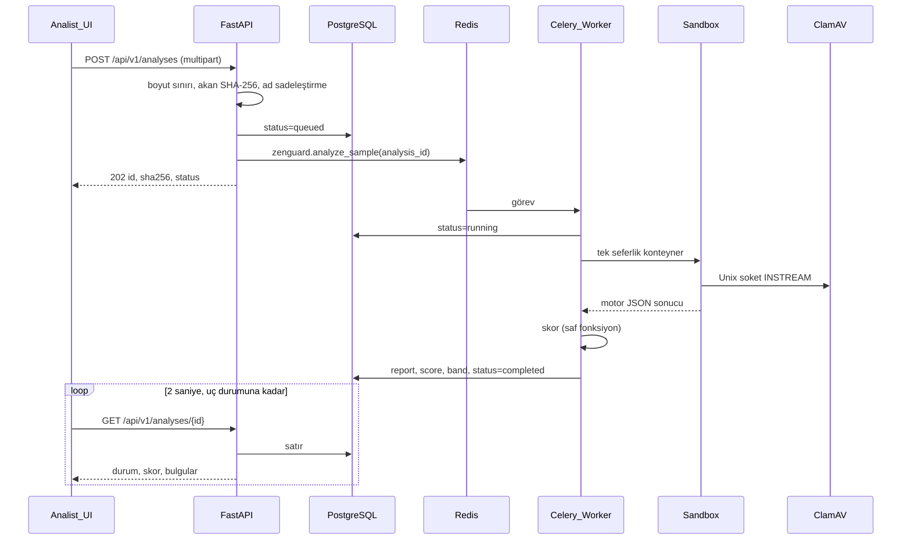

# ZenGuard — Sistem Mimarisi

ZenGuard, analistin yüklediği dosyayı ana API'yi bekletmeden kuyruğa alır; arşivi güvenli sınırlar içinde açar; ClamAV, YARA ve statik sinyalleri ayrı ayrı çalıştırır; sonucu 0–100 açıklanabilir bir risk skoruna ve JSONB rapora dönüştürür.

Bu belge v1 için kilitlenen mimaridir. Uygulama kodu fazlara bölünmüş `CHECKLIST.md` ile yazılır. Katsayı, limit ve durum adları burada tanımlanır; sonraki fazlar aynı adı ikinci bir anlamda kullanmaz.

## 1. Kapsam

v1 tek operatörlü bir analist istasyonudur. Arayüz ve API yerelde çalışır. Çok kullanıcılı kimlik doğrulama, kiracı ayrımı ve genel internete açık dağıtım bu sürümün dışındadır.

v1'in yaptığı iş:

- Dosyayı akış halinde alıp SHA-256 özetini çıkarmak
- Analizi Redis kuyruğuna bırakıp HTTP isteğini hemen kapatmak
- Arşivi bomb, derinlik, dosya sayısı ve dizin kaçışı sınırlarıyla açmak
- Bilinen imza (ClamAV), kural (YARA) ve statik sinyalleri toplamak
- Skoru gerekçeleriyle saklamak ve dashboard'da göstermek

v1'in yapmadığı iş:

- Örneği çalıştırmak, davranış analizi veya ağ trafiği kaydı
- Canlı bir ağa bağlanarak dosyanın dışarı çıkması
- Ham günlükleri skor bahanesiyle "temiz" saymak

## 2. Güven sınırları

| Bölge | Güven | Görevi |
| --- | --- | --- |
| Tarayıcı | Operatör | Dosyayı seçer, skoru okur |
| FastAPI | Güvenilen kontrol | Doğrulama, özet, kayıt, kuyruk |
| PostgreSQL | Güvenilen veri | Geçmiş ve rapor |
| Redis | Güvenilen kuyruk | Görev teslimi |
| Celery worker | Güvenilen kontrol | Sandbox'ı başlatır, skoru yazar |
| ClamAV | Güvenilen motor | İmza veri tabanı ve tarama |
| Sandbox konteyneri | Güvenilmez örnek burada işlenir | Açma, YARA, statik tarama |
| Docker soketi | Kök eşdeğeri kontrol | Yalnızca worker'a bağlıdır |

Örnek dosya güvenilmez girdidir. Disk üzerindeki ad, SHA-256'dan türetilir. İstemcinin gönderdiği dosya adı yalnızca görüntü için saklanır ve yol parçaları atılır.

Sandbox, örneğin çalıştığı izolasyon sınırıdır. Worker, konteyneri Docker Engine API ile başlatır; örnek adını bir kabuk dizesine eklemez. Argümanlar dizi olarak verilir. v1'de bu soket kabul edilen bir kontrol düzlemi riskidir ve yalnızca worker servisine bağlanır.

## 3. Mantıksal mimari

```text
Analist (Next.js)
        │  HTTPS / yerelde HTTP
        ▼
FastAPI  ──yazır/okur──► PostgreSQL
   │                         ▲
   │ görev                   │ skor + JSONB rapor
   ▼                         │
 Redis  ──► Celery worker ──┘
                │
                │ tek seferlik konteyner
                ▼
            Sandbox  (network: none)
                │  Unix soket
                ▼
             ClamAV clamd
```

İmza güncellemesi (`freshclam`) ClamAV servisinin işidir ve dış ağa çıkar. Sandbox'ın varsayılan ağı yoktur. Tarama kanalı, iki konteynerin paylaştığı Unix soketidir.

## 4. Monorepo klasör ağacı

Hedef ağaç. Her dalın hangi fazda doldurulacağı parantezde yazılıdır.

```text
ZenGuard/
├── ARCHITECTURE.md
├── CHECKLIST.md
├── README.md                      (Faz 1 iskelet, Faz 6 demo adımları)
├── docker-compose.yml             (Faz 1 infra, sonraki fazlar servis ekler)
├── .env.example                   (Faz 1)
├── .gitignore                     (Faz 1)
├── backend/                       (Faz 2+)
│   ├── Dockerfile
│   ├── pyproject.toml
│   ├── alembic.ini
│   ├── alembic/
│   │   └── versions/
│   ├── app/
│   │   ├── main.py                # uygulama fabrikası, /api/v1
│   │   ├── api/
│   │   │   ├── deps.py
│   │   │   └── routes/
│   │   │       ├── health.py
│   │   │       ├── analyses.py
│   │   │       └── uploads.py
│   │   ├── core/
│   │   │   └── config.py          # pydantic-settings, tek katsayı kaynağı
│   │   ├── db/
│   │   │   ├── session.py         # API: asyncpg, worker: psycopg senkron
│   │   │   └── models.py          # SQLModel
│   │   ├── schemas/
│   │   │   └── analysis.py
│   │   ├── services/
│   │   │   ├── hashing.py
│   │   │   ├── storage.py
│   │   │   └── scoring.py         # saf fonksiyon, Faz 4
│   │   ├── engines/
│   │   │   ├── archive.py
│   │   │   ├── clamav.py
│   │   │   ├── yara_scan.py
│   │   │   └── static.py
│   │   ├── workers/
│   │   │   ├── celery_app.py
│   │   │   └── tasks.py
│   │   └── sandbox/
│   │       └── runner.py          # docker run, kabuk yok
│   └── tests/
├── frontend/                      (Faz 5)
│   ├── Dockerfile
│   ├── app/
│   ├── components/
│   │   ├── upload-dropzone.tsx
│   │   ├── risk-gauge.tsx
│   │   ├── finding-card.tsx
│   │   └── analysis-history.tsx
│   └── lib/
│       └── api.ts
├── sandbox/                       (Faz 4)
│   ├── Dockerfile
│   └── README.md                  # izolasyon bayraklarının kısa listesi
├── rules/
│   └── yara/                      (Faz 3)
│       ├── eicar.yar
│       ├── suspicious_strings.yar
│       └── archive_traps.yar
└── samples/
    └── fixtures/                  (Faz 6, zararlı yazılım yok)
```

Karantina dosyaları repoya girmez. Konum: volume `quarantine`, düzen `{sha256[0:2]}/{sha256}`.

## 5. Çalışma zamanı servisleri

Tek Docker ağı: `zenguard`. Yayınlanan portlar yalnızca `127.0.0.1` üzerindedir.

| Servis | İmaj | Faz | Port | Volume |
| --- | --- | --- | --- | --- |
| `postgres` | `postgres:16` | 1 | 5432 | `pgdata` |
| `redis` | `redis:7` | 1 | 6379 | `redisdata` (AOF açık) |
| `clamav` | `clamav/clamav:stable` | 1 | iç ağ 3310 | `clamav-db`, `clamav-run` |
| `backend` | yerel Dockerfile | 2 | 8000 | `quarantine` |
| `worker` | backend imajı, Celery komutu | 4 | yok | `quarantine`, Docker soketi |
| `sandbox` | `sandbox/Dockerfile` | 4 | yok, ağ yok | örnek salt okunur, `rules` salt okunur, `clamav-run` soketi |
| `frontend` | yerel Dockerfile | 5 | 3000 | yok |

Sağlık uçları:

- Postgres: `pg_isready`
- Redis: `PING`
- ClamAV: iç ağda `PING` / `VERSION` (TCP 3310)
- API: `GET /api/v1/health` → `api`, `db`, `redis`, `clamav` alanları `ok` veya `down`

Sandbox servis olarak ayakta beklemez. Worker her görev için tek seferlik konteyner başlatır.

### Sandbox başlatma sınırı

Her çalıştırma şu sınırlarla açılır:

- `network_mode: none`
- CPU: `0.5`
- Bellek: `512m`
- PID: `128`
- `read_only` kök dosya sistemi
- `cap_drop: ALL`
- `no-new-privileges`
- geçici iş dizini: `tmpfs` en fazla 128 MiB
- kullanıcı: kök olmayan sabit UID
- kurallar: salt okunur bağlama
- örnek: salt okunur bağlama
- ClamAV: `/run/clamav/clamd.sock` Unix soketi

Süre üst sınırı 120 saniyedir. Süre dolunca worker konteyneri durdurur, analizi `failed` yazar, skoru boş bırakır.

`ZENG_SANDBOX_MODE` iki değer alır. `docker` desteklenen izolasyon sınırıdır. `inprocess` yalnızca motor birim testleri içindir ve örnek izolasyonu sayılmaz.

## 6. Haberleşme akışı



Aynı SHA-256 için açık bir `queued` veya `running` kayıt varsa API yeni satır açmaz; mevcut kaydın kimliğini döner. Uç durumundaki kayıt, `rescan=true` gelmedikçe yeniden taranmaz. `rescan=true` yeni bir satır açar; eski rapor durur. Özet sütunu benzersiz değildir.

Durum makinesi:

```text
queued → running → completed
queued → running → failed
queued → running → rejected
```

Uç durumlar: `completed`, `failed`, `rejected`. Bu üçünden geri dönüş yoktur.

v1 durum takibi 2 saniyelik `GET` yoklamasıdır. Arayüz uç durumda durur.

## 7. API sözleşmesi

Önek: `/api/v1`. Gövde sınırı: 50 MiB (`52428800`). Doğrulama Pydantic ile yapılır.

| Yöntem | Yol | Sonuç |
| --- | --- | --- |
| `GET` | `/health` | Bağımlılık durumu |
| `POST` | `/analyses` | `202` analiz kimliği, SHA-256, durum. Alan: `file`. Sorgu: `rescan` |
| `GET` | `/analyses/{id}` | Tek kayıt. Yoksa `404` |
| `GET` | `/analyses` | `limit`, `offset`, isteğe bağlı `sha256`, `status`. Yeni kayıt önce |

`POST` gövdesi diske yazılmadan önce bellektekine toplanmaz. Özet, yazılan akıştan hesaplanır. Boyut aşılırsa `413` ve yarım dosya silinir; satır açılmaz.

Yükleme yanıtı:

```json
{
  "id": "uuid",
  "sha256": "64 hex",
  "status": "queued",
  "original_filename": "ornek.zip",
  "size_bytes": 1234
}
```

Ayrıntı yanıtı satır alanlarına ek olarak `report` nesnesini taşır. Skor henüz yokken `risk_score` ve `report` boştur.

## 8. Veri modeli

ORM: SQLModel (SQLAlchemy 2.0 + Pydantic). API oturumu `asyncpg` kullanır. Celery görevi senkron `psycopg` oturumu kullanır. Aynı async oturum worker içine taşınmaz.

Durum ve bant, PostgreSQL enum yerine `TEXT` artı `CHECK` kısıtıdır.

### `analyses`

| Sütun | Tip | Kural |
| --- | --- | --- |
| `id` | UUID | API üretir, birincil anahtar |
| `created_at` | `timestamptz` | sunucu varsayılanı `now()` |
| `updated_at` | `timestamptz` | her yazmada güncellenir |
| `started_at` | `timestamptz` | `running` olunca |
| `finished_at` | `timestamptz` | uç durumda |
| `original_filename` | `varchar(255)` | yalnızca taban ad |
| `sha256` | `char(64)` | küçük harf hex |
| `size_bytes` | `bigint` | yüklenen bayt |
| `mime_type` | `text` | sihirli bayt sonucu; yoksa `application/octet-stream` |
| `storage_path` | `text` | karantina göreli yolu |
| `status` | `text` | `queued`, `running`, `completed`, `failed`, `rejected` |
| `risk_score` | `smallint` | 0–100 veya boş |
| `risk_band` | `text` | `clean`, `low`, `medium`, `high`, `critical` veya boş |
| `coverage` | `text` | `full`, `partial`, `none` veya boş |
| `ruleset_version` | `text` | YARA kural kümesinin sürüm damgası |
| `engine_versions` | `jsonb` | ClamAV ve YARA sürümleri |
| `task_id` | `text` | Celery görev kimliği |
| `error_code` | `text` | makine kodu |
| `error_message` | `text` | operatöre kısa mesaj |
| `report` | `jsonb` | rapor şeması sürüm 1 |

İndeksler: `sha256`, `status`, `created_at DESC`, `risk_score`, `report` üzerinde GIN.

Bulgular v1'de ayrı tabloya yazılmaz. Tek yazma yolu `report` JSONB alanıdır. Böylece skor ve gerekçe aynı kayıtta kalır.

## 9. JSONB rapor şeması

`report.report_version` değeri `1` dir.

```json
{
  "report_version": 1,
  "coverage": "full",
  "members": [
    {
      "path": "ornek.bin",
      "sha256": "…",
      "size_bytes": 68,
      "depth": 0,
      "mime_type": "text/plain"
    }
  ],
  "engines": {
    "clamav": {"status": "ok", "signature": null},
    "yara": {"status": "ok", "matches": []},
    "static": {"status": "ok", "signals": []},
    "archive": {"status": "skipped", "signals": []}
  },
  "score": {
    "mode": "weighted_sum",
    "value": 0,
    "band": "clean",
    "raw_sum": 0,
    "clipped": 0,
    "components": {
      "clamav": {"awarded": 0, "max": 55, "reasons": []},
      "yara": {"awarded": 0, "max": 40, "reasons": []},
      "static": {"awarded": 0, "max": 15, "reasons": []},
      "archive": {"awarded": 0, "max": 10, "reasons": []}
    }
  }
}
```

Politika reddinde `score.mode` değeri `policy_override` olur. Bileşenler puanlanmaz. Tek gerekçe, ihlal kodunu ve sınırı taşır. `value` 100, `band` `critical`, `coverage` `none` olur.

Gerekçe nesnesi ortak alanlar taşır: `code`, `points`, `member_path`, `evidence`. YARA gerekçesi ayrıca `rule` ve `severity` taşır.

## 10. Analiz hattı

Sıra sabittir:

1. API özeti ve karantina yazımı (görevden önce biter)
2. Tür tanıma (sihirli bayt)
3. Arşivse güvenli açma
4. Üye listesi (kök dosya derinlik 0)
5. Her üye için ClamAV, sonra YARA, sonra statik
6. Skor
7. Tek transaction ile rapor, skor, bant, uç durum

### Arşiv sınırları

v1 okuyucuları: `zipfile`, `tarfile`, `py7zr`. Formatlar: zip, tar, tar.gz, tar.bz2, 7z.

Derinlik:

- Yüklenen nesne derinlik 0
- Bir arşivin üyeleri bir sonraki derinliktir
- En derin izin verilen üye derinlik 3'tür
- Derinlik 3'teki bir arşivin içi açılmaz

Örnek: `a.zip` → `b.zip` → `c.zip` → `d.txt` geçerlidir (`d.txt` derinlik 3). `d.zip` içinde `e.txt` gerekirsen durulur; kod `ARCHIVE_DEPTH`.

| Sınır | Değer | Aşım kodu | Sonuç |
| --- | --- | --- | --- |
| Yükleme | 50 MiB | HTTP `413` | satır yok |
| Açılmış toplam | 100 MiB (`104857600`) | `SIZE_LIMIT` | `rejected`, skor 100 |
| Üye sayısı | 200 | `ARCHIVE_COUNT` | `rejected`, skor 100 |
| Derinlik | 3 | `ARCHIVE_DEPTH` | `rejected`, skor 100 |
| Sıkıştırma oranı | `>= 1000` | `ZIP_BOMB` | `rejected`, skor 100 |
| Üye yolu | `..`, mutlak yol, sürücü öneki | `PATH_TRAVERSAL` | `rejected`, skor 100 |
| Sembolik bağ | herhangi biri | `UNSAFE_MEMBER` | `rejected`, skor 100 |

Oran, yazılan açılmış baytın sıkıştırılmış boyuta bölümüdür. Başlıktaki beyan tek başına yeterli sayılmaz. Sayaç, yazarken ilerler; sınır aşılınca iş dizini silinir ve motorlar çalışmaz.

Oran `100` ile `999` arasındaysa açma sürer ve arşiv bileşenine `suspicious_ratio` (+6) yazılır.

Şifreli arşiv açılmaz. Kod puanı `encrypted_archive` (+5). Kapsam `partial`. İç üyeler taranmış gibi gösterilmez.

## 11. Motorlar

### ClamAV

Kanal, sandbox içinden Unix soket `INSTREAM` taramasıdır. Sağlık kontrolü iç ağ TCP 3310 kullanır.

Puan girdisi analiz genelindedir:

- Zararlı imza yoksa ve PUA yoksa: 0
- Yalnızca `PUA.*` veya `Heuristics.*`: 25
- En az bir zararlı yazılım imzası: 55

İmza adı gerekçenin `evidence.signature` alanındadır.

### YARA

Kurallar `rules/yara/*.yar` altındadır. `ruleset_version`, kural dosyalarının içeriğinin SHA-256 özetidir. Tarayıcı kuralları her dosyada yeniden derlemez; worker süreci başlarken derler, sürüm değişince yeniden derler.

Kural meta alanı `severity` alır: `info`, `low`, `medium`, `high`, `critical`. Alan yoksa `medium` sayılır.

Aynı `rule` adı analizde bir kez puanlanır. Eşleşen üye yolları `evidence.paths` içine toplanır.

### Statik sinyaller

Ağ çağrısı yoktur. Her sinyal bir üye yolunda bir kez sayılır. Küresel toplam 15 ile sınırlanır.

| `signal_id` | Puan | Koşul |
| --- | --- | --- |
| `entropy_high` | 5 | Shannon entropisi `>= 7.2`, boyut `>= 4096`, çalıştırılabilir veya bilinmeyen ikili |
| `packer_section` | 4 | Bölüm adı `UPX0`, `UPX1`, `.aspack`, `.adata`, `MPRESS1`, `.petite` |
| `double_extension` | 4 | Son uzantı çalıştırılabilir kümede, önceki uzantı belge kümesinde |
| `office_macro` | 6 | OLE içinde `vbaProject.bin` veya makro akışı |
| `pe_rwe_section` | 3 | Yazılabilir ve çalıştırılabilir bölüm |
| `pe_tls_callback` | 3 | TLS geri çağrı girdisi var |
| `pe_no_imports` | 3 | İçe aktarma tablosu boş PE |
| `script_exec` | 5 | Betik uzantısı ve sabit çalıştırma kalıbı listesi |

Betik kalıpları repo içindeki sabit listededir. Liste motorun parçasıdır; skor hesabı listeyi uzatmak için dışarı çıkmaz.

### Arşiv puanı

İçeriğin imza ve YARA puanından ayrıdır. Küresel toplam 10 ile sınırlanır.

| `signal_id` | Puan | Koşul |
| --- | --- | --- |
| `encrypted_archive` | 5 | Üye veya kök şifreli |
| `extension_mismatch` | 3 | Ad uzantısı ile sihirli bayt formatı farklı |
| `nested_depth_max` | 4 | Derinlik 3'te açılmamış bir arşiv üyesi var |
| `high_file_count` | 3 | Üye sayısı 100'den çok ve 200'den az ya da 200 |
| `suspicious_ratio` | 6 | Bir üyede oran `>= 100` ve `< 1000` |

## 12. Risk skoru matematiği

Skor tamsayıdır. Ara adımda yuvarlama yoktur.

```text
C = 0 | 25 | 55          üst sınır 55
Y = min(40, Σ kural)     info 0, low 5, medium 10, high 20, critical 40
T = min(15, Σ sinyal)
A = min(10, Σ arşiv)

raw_sum      = C + Y + T + A     kuramsal üst sınır 120
evidence_sum = min(100, raw_sum)
clipped      = raw_sum - evidence_sum

score =
    100    C = 55                         mode = certainty_sure
    90     C < 55 ve kritik YARA var      mode = certainty_indicator
    85     C < 55 ve yüksek YARA var      mode = certainty_indicator
    evidence_sum   aksi halde             mode = weighted_sum
```

EICAR kural adları (`eicar`, `eicar_test`) taban uygulamaz. Onlar ClamAV imzasıyla birlikte gelirse skor 100 olur; imza yoksa kanıt puanında kalır.

Taban, parça puanlarının üstüne yazılır. Parçalar kanıt olarak durur: ClamAV 0 görünüp skorun 90 olması, gövdenin görülmediği ve kalıbın tehdit sınıfı sayıldığı anlamına gelir.

Bant:

| Skor | Bant |
| --- | --- |
| 0 | `clean` |
| 1–24 | `low` |
| 25–49 | `medium` |
| 50–79 | `high` |
| 80–100 | `critical` |

Parça puanı kanıttır, son skor değildir. ClamAV zararlı imzası gövdeyi gördüğü için skor 100'e çıkar. Kritik veya yüksek bir YARA kuralı niyeti gösterir ama gövdeyi göstermez; skor 90 veya 85 olur. Statik sinyaller yapı ipucudur (en çok 15) ve tek başlarına taban uygulamaz. Arşiv puanı bağlamdır (en çok 10); zip bombası ve yol kaçışı gibi politika reddi zaten 100'dür. `clipped` yalnızca 100 tavanından kesilen parça puanıdır.

Politika reddi (`ZIP_BOMB`, `SIZE_LIMIT`, `ARCHIVE_COUNT`, `ARCHIVE_DEPTH`, `PATH_TRAVERSAL`, `UNSAFE_MEMBER`) ağırlıklı toplamdan ayrıdır: `mode = policy_override`, skor 100, bant `critical`.

### İşlenmiş örnekler

| Senaryo | C | Y | T | A | raw | skor | bant |
| --- | --- | --- | --- | --- | --- | --- | --- |
| Düz metin, motorlar temiz | 0 | 0 | 0 | 0 | 0 | 0 | clean |
| Yalnız PUA | 25 | 0 | 0 | 0 | 25 | 25 | medium |
| Yalnız kritik YARA (EICAR kuralı değil) | 0 | 40 | 0 | 0 | 40 | 90 | critical |
| Yalnız yüksek YARA | 0 | 20 | 0 | 0 | 20 | 85 | critical |
| Makro + yüksek entropi + çift uzantı | 0 | 0 | 15 | 0 | 15 | 15 | low |
| Kritik YARA + bu üç statik sinyal | 0 | 40 | 15 | 0 | 55 | 90 | critical |
| EICAR: zararlı imza + kritik YARA | 55 | 40 | 0 | 0 | 95 | 100 | critical |
| Dört bileşen tavanı | 55 | 40 | 15 | 10 | 120 | 100 | critical |
| ZIP bomb politika reddi | — | — | — | — | — | 100 | critical |

EICAR satırı, ClamAV'ın test imzasını ve `rules/yara/eicar.yar` kritik kuralını birlikte varsayar. Faz 6 bu satırı beklenen sonuç olarak kullanır.

### Skor üretilmeyen durumlar

ClamAV veya YARA motoru hata verirse durum `failed` olur. `risk_score` boş kalır. Sessizce 0 yazılmaz.

Tek bir üyede statik çözümleme hatası, analizi düşürmez. O üye için 0 puanlık `static_error` gerekçesi yazılır ve kapsam `partial` olur.

## 13. Ortam değişkenleri

Değerler `.env.example` içindedir. Gerçek `.env` repoya girmez.

| Değişken | Rol |
| --- | --- |
| `POSTGRES_USER`, `POSTGRES_PASSWORD`, `POSTGRES_DB` | Veritabanı |
| `DATABASE_URL` | API için `postgresql+asyncpg://…` |
| `DATABASE_URL_SYNC` | Worker için `postgresql+psycopg://…` |
| `REDIS_URL` | `redis://…` Celery broker ve sonuç |
| `CELERY_RESULT_TTL_SECONDS` | `3600`. Asıl sonuç PostgreSQL'dedir |
| `CLAMAV_SOCKET` | `/run/clamav/clamd.sock` |
| `CLAMAV_TCP_ADDR` | sağlık için `clamav:3310` |
| `ZENG_SANDBOX_MODE` | `docker` veya `inprocess` |
| `ZENG_MAX_UPLOAD_BYTES` | `52428800` |
| `ZENG_MAX_UNCOMPRESSED_BYTES` | `104857600` |
| `ZENG_MAX_ARCHIVE_DEPTH` | `3` |
| `ZENG_MAX_ARCHIVE_FILES` | `200` |
| `ZENG_ZIP_BOMB_RATIO` | `1000` |
| `ZENG_SANDBOX_TIMEOUT_SECONDS` | `120` |
| `NEXT_PUBLIC_API_BASE` | `http://127.0.0.1:8000/api/v1` |

Skor katsayıları ortam değişkeni değildir. Tek kaynak bu belgedeki tablolardır; Faz 4 onları `scoring` modülünde sabitler.

## 14. Kilitlenen kararlar

- ORM SQLModel'dir. API asenkron, worker senkron oturum kullanır.
- Bulgular JSONB içindedir.
- Skor tamsayıdır; formül bölüm 12'dir.
- İzolasyon sınırı tek seferlik sandbox konteyneridir (`network: none`).
- v1 arayüzü skoru 2 saniyelik yoklama ile izler.
- Örnek çalıştırılmaz. Statik analiz dışına çıkılmaz.
- Test gereçleri EICAR ve sentetik arşivlerdir. Gerçek zararlı örnek repoya konmaz.
